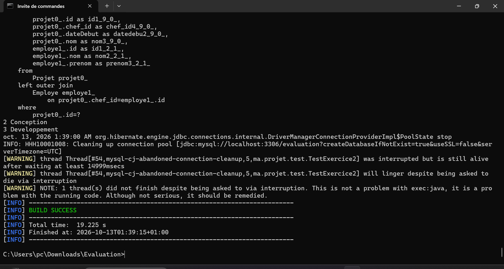
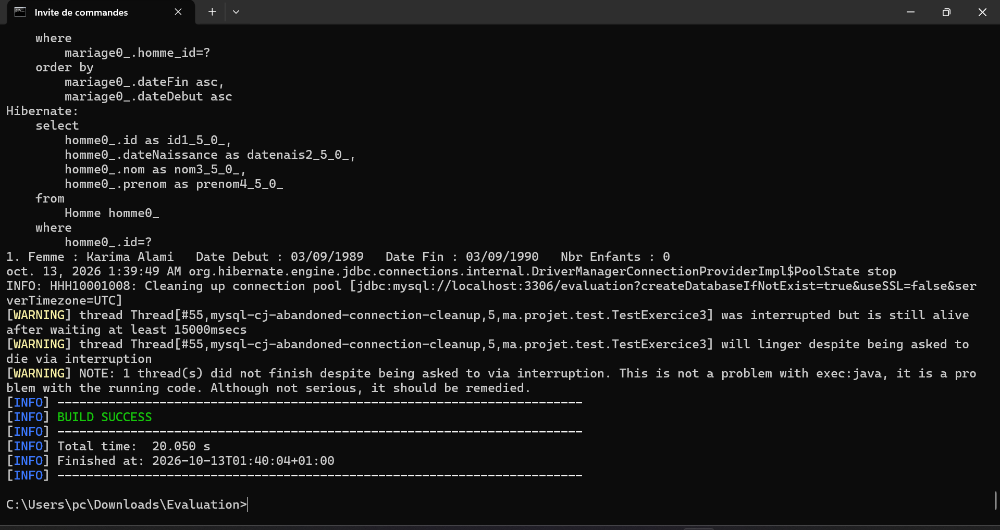
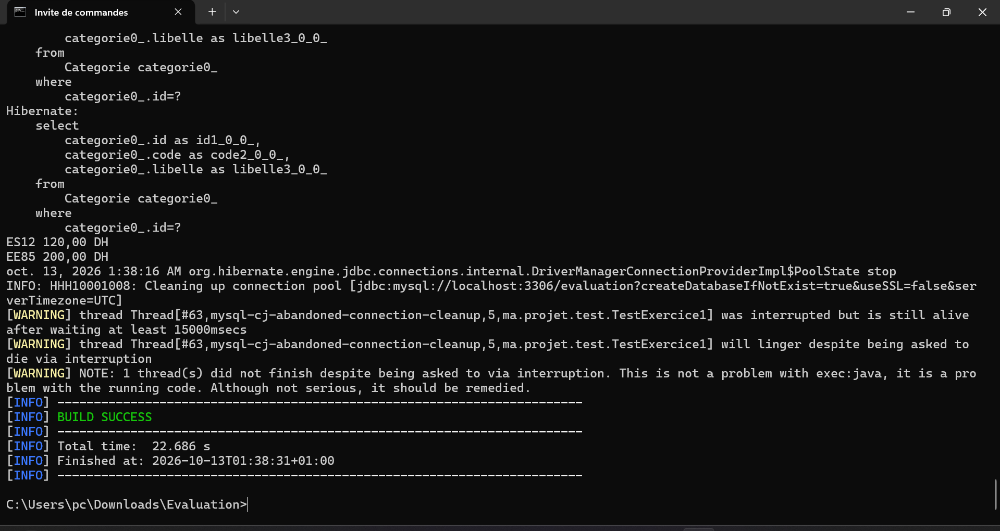

# Evaluation

Ce projet contient les exercices Hibernate/JPA demandes pour la gestion de stock, la gestion de projets et la gestion de l'etat civil.

## Prises d'ecran d'execution

La capture suivante montre l'execution du premier exercice. Elle valide les traitements lies aux produits, categories, commandes et lignes de commande.

La capture suivante montre l'execution du deuxieme exercice. Elle valide les traitements lies aux projets, taches, employes et realisations.

La capture suivante montre l'execution du troisieme exercice. Elle valide les traitements lies aux hommes, femmes, mariages et requetes demandees.

